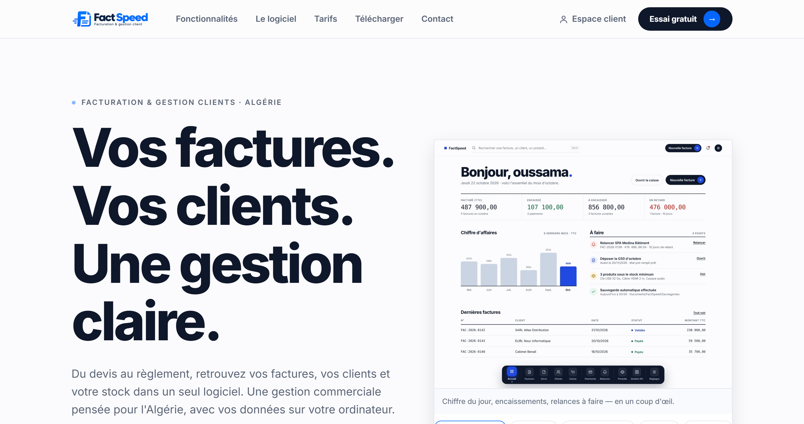
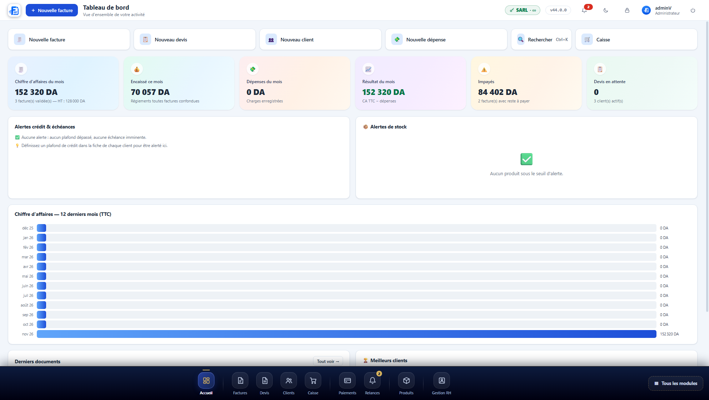
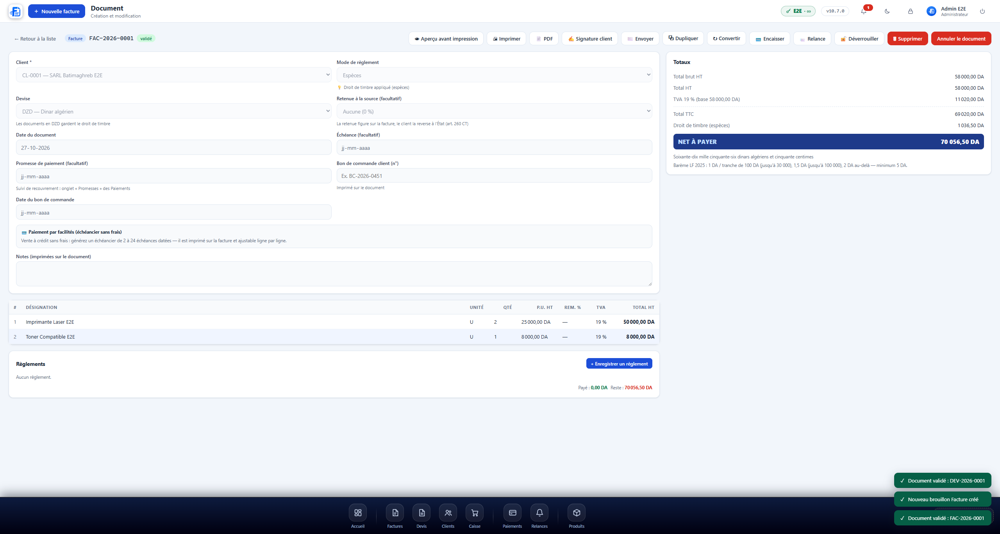
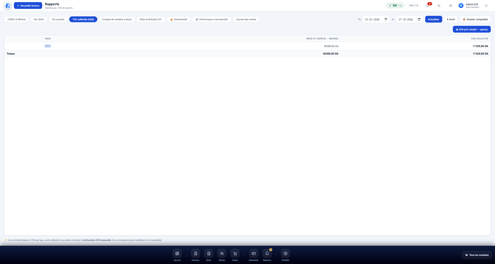
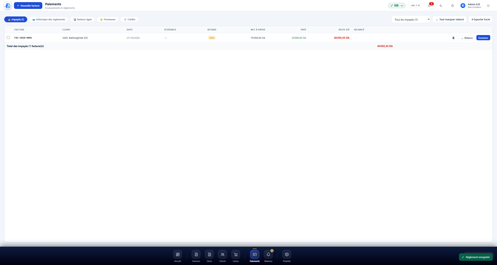

  <picture>
    <source media="(prefers-color-scheme: dark)" srcset="../icon-512.png" width="110" />
    
  </picture>

   

  ### Le logiciel de facturation pensé pour les entreprises algériennes

  Devis · Factures conformes DGI · Relances · Caisse POS · Stock · RH/paie CNAS · Comptabilité
  **Vos données restent sur votre ordinateur. Aucun abonnement cloud obligatoire.**

   

  
  
  
  
  

   

  [🌐 Site officiel](https://factspeed.com) · [⬇️ Télécharger l'essai](https://factspeed.com/telecharger) · [💰 Tarifs](https://factspeed.com/tarifs) · [📦 Installateurs](https://github.com/derouicheoussama/factspeed-releases) · [🆘 Support & suggestions](https://github.com/FactSpeed/factspeed-support) · [💬 WhatsApp 7 j/7](https://wa.me/213770600957)

   

  

---

## 🧾 Qu'est-ce que FactSpeed ?

**FactSpeed** est un logiciel de gestion commerciale complet, conçu en Algérie
pour les commerçants, artisans, prestataires et PME. Il remplace le trio
Excel + Word + carnet : vos **devis**, **factures**, **clients**, **stock**,
**caisse** et **paie** vivent dans une seule application rapide, installée sur
votre ordinateur — vos données commerciales ne quittent jamais votre machine.

Il est développé et maintenu par **Derouiche Oussama — ∞ Infinity Coder**
(Oran), avec un support direct par WhatsApp 7 j/7 : vous parlez au développeur,
pas à un robot.

## 📸 Le logiciel en images

| | |
|---|---|
|  **Tableau de bord** — CA, encaissé, impayés, alertes crédit & stock, meilleurs clients |  **Facture conforme** — TVA par taux, droit de timbre automatique, montant en lettres |
|  **G50 pré-rempli** — TVA collectée par taux, export Excel |  **Impayés & relances** — suivi par ancienneté, relances email imprimables |

## 🆕 Dernières nouveautés

| Version | Nouveauté |
|---|---|
| **10.14.32** | 🎨 Palette du dock : **10 teintes authentiques nommées** + aperçu en direct |
| **10.14.31** | ⏳ **Barre de progression** pendant l'envoi de la commande (étapes réelles) |
| **10.14.30** | ♾ **Offre à vie** visible dans la commande intégrée (Pro 36 000 · Duo 60 000 · Business 72 000 DA) |
| **10.14.29** | 🔐 Anti-clonage renforcé : une licence copiée vers un autre PC est bloquée immédiatement |

📖 Historique complet : [installateurs & notes de version](https://github.com/derouicheoussama/factspeed-releases/releases)

## 🧩 Les modules, en détail

### 🧾 Facturation & documents
Devis, proformas, factures, bons de livraison, avoirs, bons de commande,
acomptes — avec numérotation automatique, brouillon → validé, conversions en
1 clic (devis → facture → avoir/BL), signatures client, échéanciers sans frais
et 12 modèles imprimables en français et en arabe RTL.

### 👥 Clients & relances
Fiches complètes (RC, NIF, NIS, AI), soldes en temps réel, plafonds de crédit
avec alertes, historique complet, **relances email automatiques** et suivi des
impayés par ancienneté (30/60/90 jours).

### 🛒 Caisse POS
Vente rapide au comptoir : douchette code-barres (bip sonore), ticket de caisse,
clôture Z, mode kiosque pour écran tactile, paiements multiples (espèces,
facilités), client comptoir.

### 📦 Achats, stock & dépenses
Multi-dépôts avec transferts, mouvements automatiques liés aux factures,
inventaire, seuils d'alerte, fournisseurs, bons de commande, dépenses et
charges avec pièces jointes.

### 🧑‍💼 RH & paie
Employés, bulletins de paie conformes (**CNAS/DAS**), congés, absences, prêts,
échelonnement, documents officiels — pensé pour le droit du travail algérien.

### 📊 Comptabilité & rapports
Journal des ventes/achats, compte de résultat, bilan, TVA collectée
(**G50 pré-rempli**), chiffre d'affaires par client/produit/période, rapports
prévisionnels — tout exportable en **Excel**.

## 🏛 Conformité DGI — la spécialité de FactSpeed

- **TVA 19 % / 9 % / 0 %** calculée ligne par ligne, par taux
- **Droit de timbre** appliqué automatiquement selon le **barème LF 2025**
  (paiement en espèces) — avec le **montant en toutes lettres** imprimé
- **G50 pré-remplie** : TVA collectée par taux, base HT, déductions — export Excel
- Mentions obligatoires imprimées : **RC, NIF, NIS, AI**, devise DZD,
  montants au format « 1 234 567,00 DA »
- Numérotation officielle : FAC-2026-0001, DEV-2026-0001… (préfixes paramétrables)

## 🔒 Vos données restent chez vous

- **100 % local** : la base de données vit sur VOTRE disque. Internet n'est
  requis que pour les mises à jour et l'activation de la licence.
- **Sauvegardes chiffrées** automatiques et programmées, avec restauration vérifiée
- Licences signées **Ed25519**, liées à l'ordinateur — **anti-clonage** :
  une licence copiée vers un autre PC est détectée et bloquée
- Aucune télémétrie, aucun envoi de données clients — honnêteté par conception

## 💻 Configuration requise

| | Windows | macOS |
|---|---|---|
| Système | Windows 10 ou 11 (64 bits) | macOS 12 Monterey ou plus récent |
| Mémoire | 4 Go (8 Go recommandé) | 4 Go (8 Go recommandé) |
| Disque | 500 Mo + sauvegardes | 500 Mo + sauvegardes |
| Internet | À l'installation et pour les mises à jour | Idem |
| Imprimante | A4 / ticket (POS) — toute imprimante Windows/macOS | Idem |

## 🚀 Installation en 3 étapes

1. **Téléchargez l'essai gratuit** (10 jours complets, sans carte bancaire) depuis
   [factspeed.com/telecharger](https://factspeed.com/telecharger)
2. **L'assistant de bienvenue** crée votre entreprise, votre exercice fiscal et
   votre compte administrateur en 2 minutes (wizard FR ou AR)
3. **Travaillez** — à la fin de l'essai, vos données sont conservées : il suffit
   d'activer une licence (clé envoyée par email après validation de la commande)

## 💰 Tarifs simples

| Offre | Prix | Postes | Pour qui |
|---|---|---|---|
| 🎁 **Essai** | **Gratuit — 10 jours** | 1 | Tester tout, sans carte bancaire |
| **Pro** | 12 000 DA/an | 1 | Commerçants & indépendants |
| **Duo** | 20 000 DA/an | 2 | Comptoir + bureau |
| **Business** | 24 000 DA/an/poste | illimité | Équipes & succursales |
| ♾ **À vie** | dès 36 000 DA | selon pack | Payer une fois, garder pour toujours |

## ❓ Questions fréquentes

**Mes données partent sur Internet ?**
Non. Tout est stocké sur votre disque dur. Internet sert uniquement à
l'activation, aux mises à jour et aux relances email que VOUS décidez d'envoyer.

**Et si mon PC tombe en panne ?**
Les sauvegardes automatiques chiffrées se restaurent en un clic sur un autre
ordinateur (votre licence suit votre code machine — le support vous accompagne).

**Je peux l'utiliser sur 2 ordinateurs ?**
Oui, avec le pack **Duo** (2 postes) ou **Business** (illimité, au poste).
Une licence copiée d'un PC à l'autre est détectée et bloquée.

**Les mises à jour sont payantes ?**
Non — incluses dans l'abonnement annuel. La version **à vie** inclut
également les mises à jour, pour toujours.

**C'est conforme à la loi de finances en vigueur ?**
Oui — TVA, droit de timbre (barème LF 2025), G50 et mentions obligatoires
sont appliqués automatiquement, et les barèmes se mettent à jour sans
réinstaller le logiciel à chaque loi de finances.

## 🆘 Support & contact

- 💬 **WhatsApp +213 770 600 957** — 7 j/7, vous parlez au développeur
- 📧 **hi@factspeed.com**
- 🌐 **[factspeed.com](https://factspeed.com)** — guides, tarifs, téléchargement
- 🐛 **[Signaler un bug / suggérer une idée](https://github.com/FactSpeed/factspeed-support/issues)** — canal public suivi

---

  © 2026 Derouiche Oussama — ∞ Infinity Coder (Oran, Algérie).
  Chaque projet signé, chaque client accompagné.

